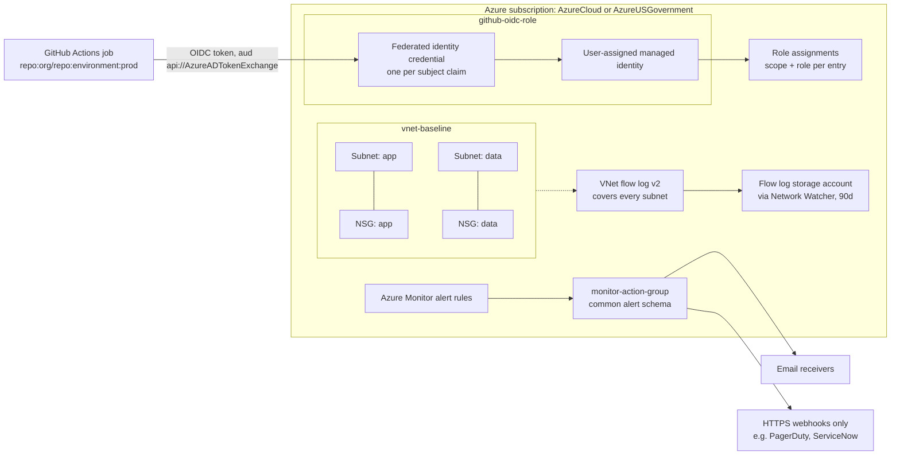

# terraform-azure-platform-modules

Small, opinionated Terraform modules for a secure Azure platform baseline. Works **unchanged in both Azure commercial and Azure Government** by letting the caller configure the `azurerm` provider with `environment = "usgovernment"`.

| Module | What it does | Key defaults |
|---|---|---|
| [`vnet-baseline`](modules/vnet-baseline) | Multi-subnet VNet with per-subnet NSGs and VNet flow logs | One NSG per subnet, all associated; VNet flow logs on by default (version 2, 90d retention), plan fails without a storage account |
| [`github-oidc-role`](modules/github-oidc-role) | User-assigned managed identity with federated credentials for GitHub Actions (no client secrets) | Rejects wildcard `sub` claims like `repo:*` / `repo:org/*`; supports multiple claims per identity |
| [`monitor-action-group`](modules/monitor-action-group) | Azure Monitor action group for email and webhook notifications | Webhook URIs enforced `https://`; treated as sensitive — URLs never appear in resource addresses |

## Architecture



## Usage

```hcl
provider "azurerm" {
  features {}
  # For Azure Government: environment = "usgovernment"
}

module "vnet" {
  source = "git::https://github.com/Krustytoe/terraform-azure-platform-modules.git//modules/vnet-baseline?ref=v0.1.0"

  name                = "platform-prod"
  location            = "usgovvirginia"
  resource_group_name = "platform-rg"
  address_space       = "10.20.0.0/16"
  subnets = {
    app  = "10.20.0.0/24"
    data = "10.20.1.0/24"
  }
}
```

See [`examples/complete`](examples/complete) for a full working example covering all three modules.

## Design decisions

- **One codebase for commercial and Government.** Modules never hard-code endpoints or cloud names; the caller sets `environment = "usgovernment"` on the provider and the same code plans in either cloud.
- **Federated credentials, not client secrets.** GitHub Actions exchanges a short-lived OIDC token for the managed identity. There is no secret to rotate, leak, or expire mid-deploy.
- **Wildcard subjects are rejected at plan time.** Input validation refuses claims like `repo:*` or `repo:org/*`, so one misconfigured repo can't assume a production identity.
- **Every subnet gets its own NSG, always associated.** There is no code path that creates an unprotected subnet, and per-subnet NSGs keep rule changes scoped to one tier.
- **Sensitive values stay out of resource addresses.** Subject claims and webhook URIs are keyed by index, so org/repo names and webhook tokens don't surface in plan output, state paths, or CI logs.
- **Flow logs are on by default, at the VNet level.** VNet flow logs replace NSG flow logs, which Azure no longer allows creating. Turning them off is an explicit `enable_flow_logs = false`, and leaving out the storage account fails the plan instead of failing the deploy.
- **Webhooks must be HTTPS** and use the common alert schema, so downstream tools (PagerDuty, ServiceNow) parse a single payload format.

## Requirements

Terraform >= 1.7. Azure provider >= 4.11 for `vnet-baseline` (VNet flow logs), >= 3.100 for the other modules. Run `terraform test` inside any module directory for offline validation — no Azure credentials required.

## Testing

```bash
cd modules/<module>
terraform test
```

All tests use `mock_provider "azurerm"` so they run anywhere Terraform does.

## License

MIT
